# Course workflow V2

Historical workflow. [Course workflow V3](COURSE_WORKFLOW_V3.md) supersedes this document for new work. The original companion guides are preserved in [the V2 snapshot](artifacts/course-workflow-v3/history/README.md); the companion paths below now contain V3.

September 21, 2026. Reusable workflow for the existing **Course Ideation** and **Course Creator** tasks. This is workflow V2, not City Run map V2; the latest delivered City Run scenery is V3_FINAL_03C.

Use [Course Ideation](COURSE_IDEATION_WORKFLOW.md), [Course Creator](COURSE_CREATOR_WORKFLOW.md) and [ImageGen prompt recipes](COURSE_IMAGEGEN_PROMPTS.md) with this document. They replace conflicting earlier workflow instructions, fixed review teams and the old set of section appearance references. Applicable AGENTS.md and the owner's latest instructions still govern. The [level-design guide](LEVEL_DESIGN_GUIDE.md) remains useful for design principles; its older sequence is background, not a competing workflow.

## The working arrangement

Course Ideation develops the experience and produces a coherent handoff. Course Creator builds it in **two phases: Asset Creation, then Map Creation**. The agent handles routine decisions, revisions and relevant checks within the authorized phase. The owner chooses subagents in the current prompt and judges the phase result.

Performance and accessibility are core requirements throughout both creation phases, especially for mobile/lower-end devices and the intended full race population. Ideation carries the device/player targets into the handoff; Creator plans asset cost, checks representative assembled sections early and reports measured performance separately from visual acceptance. Unavailable device evidence remains an explicit pending check, not a reason to substitute a screenshot score or part count.

```mermaid
flowchart LR
    A[Idea and discussion] --> B[Brief and editable draw.io plan]
    B --> C[ImageGen visual package]
    C --> D[Reconciled Creator handoff]
    D --> E[Phase 1: Asset Creation]
    E --> F[Asset kit and fit studies reviewed]
    F --> G[Phase 2: Map Creation]
    G --> H[Playable candidate and handoff]
    H --> I[Owner tuning and scoped revisions]
```

Fit studies are small arrangements inside Phase 1, not a third phase or an early full-map build. Map Creation includes layout, gameplay, environment, integration, optimization and relevant verification; it must not end with an attractive empty scene.

## Decisions on the owner's suggestions

| Suggestion | V2 decision |
| --- | --- |
| Assets first, map second | Adopt. Test representative joins, proportions and a small movement fixture before multiplying the assets across the map. |
| Approve needed work for the whole phase | Adopt scoped phase authorization. Carry it forward instead of asking again for every revision or upload. Complete concrete preparation before requesting any approval that remains missing. |
| Use the new MCP | Adopt Chrrxs alongside the official Studio connection and Rojo, assigning work by capability. No reinstall or migration is part of a course by default. |
| Owner chooses helpers/reviewers | Adopt. No inherited fixed team, count, model, effort or score threshold. Without a current request for agents, work and self-review locally. |
| New Ideation visual outputs | Adopt one appearance reference, one mood board, one loose Blender-style idea image, and multiple map-layout images, all through ChatGPT ImageGen. Keep a native editable draw.io plan as the exact route authority. |

## What the first run taught us

These lessons come from the owner's messages across both completed runs, saved revision reports, and actual Studio evidence. They are not all claims that the first run fully verified gameplay or performance.

| Evidence from the run | Reusable change |
| --- | --- |
| Ideation needed clarification about clean runs, falls and player skill; final capacity/crowding decisions arrived after the saved brief. | Define what each target measures and reconcile late decisions into every handoff artifact. |
| The owner requested separate brief/prompt files, then canceled a redundant obstacle document. | Keep obstacles in the brief and prompts in one separate file. Add files only for distinct useful outputs. |
| The initial course lacked enough obstacles; owner edits added meaningful movement choices, tighter geometry and clearer directions. | Design each section's actual player actions, obstacle rhythm and recovery before decorating it. A row of platforms or long walking link is not a completed obstacle sequence. |
| The owner repeatedly preferred close, layered surroundings at player height and simple unseen scenery. | Spend detail on traversal, looking sideways/back and falling views. Dense composition is not indiscriminate clutter. |
| The depot felt like more of the same city; the terminal did not feel like an earned destination. | Give sections distinct shape/material/space rhythms and protect the finish reveal as a named visual requirement. |
| Owner edits changed colliders, signs, checkpoints and buildings while work continued. | Reconcile the live edit model with source and the last accepted backup. Preserve hand edits; patch scoped groups instead of replaying old generators. |
| Roof gaps, overlaps, unclear mounting and joined sign/arrow meshes made refinement difficult. | Define useful editable units, pivots, mounting rules and collision ownership during Asset Creation. Verify joins in Studio. |
| A later obstacle revision temporarily lost a signature wrecking-ball encounter. | Keep a named must-preserve list and verify signature hazards still exist and behave after each relevant revision. |
| The owner explicitly requested two passes and later approved all scoped work through each phase. | Record phase authorization and its end condition; do not reopen already-covered approvals. |
| The reviewed Stage 2 rebuild still stretched facades, weakened colors and diminished the terminal. | Asset-library acceptance is separate from map acceptance. Compare assembled results to the owner's visual anchors at matched views. Review scores do not override owner feedback. |
| Final03C restored the terminal while reducing overall parts; its replacement scenery had more triangles than build02. | Optimize the actual cost without sacrificing the intended experience. Report both improvements and tradeoffs; counts do not prove FPS. |
| Outages, stale Rojo source and Studio capability problems interrupted work. | Save recoverable milestones, verify state on resume, and use the correct tool/context before retrying. |

Source trail: Course Ideation task `01a073b5-8669-7ad0-974b-0657f75200b9` (September 7–8) and Course Creator task `01a073b5-a9fb-7041-8d44-b41bb28fe8b8` (September 8–16). The review covered 14 unique Ideation user messages and 66 Creator messages, including approval replies and corrections, plus the existing workflow adoption.

Useful durable evidence: [owner's opening design](artifacts/city-run/C10_OWNER_INTENT.md), [early build history](artifacts/city-run/BUILD_HISTORY_C01_C04.md), [editing and preservation](CITY_RUN_EDITING.md), [asset-kit delivery](CITY_RUN_V3_ASSET_KIT.md), [Stage 2 report](CITY_RUN_V3_STAGE2.md), and [Final03C report](CITY_RUN_V3_FINAL.md). Earlier reports describe earlier candidates; do not treat their pending items, counts or approvals as the current state.

## Authority and the current course record

The current owner instruction wins over an older brief. The reconciled brief and native draw.io file define functional intent. Accepted images guide appearance. An ImageGen map or clay image cannot quietly change checkpoint order, remove a signature hazard, add a movement ability or establish exact dimensions. If current written sources conflict, reconcile routine stale wording; ask only when the actual decision is genuinely ambiguous.

Each course has one current brief with a revision/date, accepted choices, proposals, unresolved items, and a compact change record. Keep these essentials together:

- Theme, player fantasy, start/destination, route form, capacity and target devices.
- Ordered sections: purpose, actual actions, ordinary obstacles, signature hazards, safe areas, checkpoints, branches/rejoins and transitions.
- Difficulty and timing targets with skill, route, falls and waiting defined.
- Visual anchors: density, scale, palette, section contrast, finish reward, readable route and deliberate quiet areas.
- Must-preserve mechanics/assets/manual edits, things still open to invention, exclusions and asset needs.
- Latest diagram/visual filenames, revision compatibility, phase, selected review arrangement and granted permissions.

Reuse the existing course folder. Do not impose a second registry, database or large tracking system. Build manifests can hold machine-readable dimensions, IDs, placements and file hashes when the build needs them. A short current-status note should identify the live model, durable source, accepted candidate, pending checks and next step after an interruption.

**Stud style remains unresolved.** City Run's density and player-view principles can carry forward; its city theme, hazard counts, clock tower and exact colors do not become defaults for every course. Do not call the medieval showcase or earlier stud kit an approved game-wide style.

## Phase authorization without repeated interruptions

At phase entry, state the concrete objective, named course/target, intended outputs, relevant operations and completion condition. Read permissions already granted in the conversation. Proceed with reversible local preparation and all covered work; do not ask for a ritual confirmation.

An explicit approval for a named phase can cover asset creation and revision, local exports/backups, uploading that course's assets to the confirmed creator, isolated imports/reviews, agreed gameplay integration and archiving superseded generated candidates. Record the actual scope and destination. If the owner already granted this scope, a new filename or routine revision does not automatically require another approval.

If permission for an operation is genuinely missing, finish preparing the concrete candidate and bundle the remaining decisions into one short request. Distinguish acceptance of the result from permission to perform an external action. Never invent a permission requirement merely because a document says to be careful.

Phase permission lasts until that phase is completed, revoked, or its scope materially changes. A pause suspends work; a later resume retains the granted scope unless the owner changes it. If both phases were explicitly authorized together, continue through the boundary without re-asking. Otherwise, deliver Phase 1 and wait for the owner's instruction to start Phase 2. In-phase failures or revisions do not silently reset authorization.

A general course-phase approval does not cover place publishing, purchases, account/configuration changes, DataStore/economy/security-sensitive redesigns, deleting owner work or unrelated projects. Those remain governed by the explicit request and project rules. This V2 workflow update itself authorizes no new course build or asset upload.

Automatic approval review can still block an operation. Inspect whether a safer authorized path exists; if not, identify the blocked action and the review's actual reason. Do not repeatedly retry the same blocked action or bypass a permission boundary through another connection.

## Review and completion

The owner specifies helper/reviewer count, models, effort, roles and any scoring condition in the current prompt. Do not inherit the first run's teams. If that prompt contains contradictory counts, resolve that narrow conflict before delegation; continue independent preparation meanwhile. Do not choose an extra agent or increase reasoning effort silently.

When independent reviewers are requested, give each the same candidate ID, relevant reference requirements and an adequate shared image set. They may inspect different concerns, but must judge the same unchanged build. Keep their scores independent. Do not average away a failure, transfer old-build scores, drop a reviewer, or pressure a score. A new relevant candidate needs fresh required reviews. Preserve earlier evidence as history.

Without requested agents, perform the same substantive checks locally and report self-review honestly. Reviews look for specific defects and unmet requirements; a number is not a substitute for that work. Owner acceptance, visual review, gameplay checks and device performance are separate results.

Stop when the authorized result and relevant checks are complete. Do not create endless polish loops. If iterations stop making measurable progress, identify the unresolved issue, what changed and the decision needed. Preserve working artifacts and the last accepted candidate.

## Using the same tasks again

The existing task names remain **Course Ideation** and **Course Creator**. Load these V2 documents when starting or resuming course work. Treat historical course messages as evidence, not a fresh request to rebuild them. Keep completed course files, start the next course from its new brief, and return to standby after the requested delivery.

The previous reusable Ideation document is retained as [V1 history](artifacts/course-workflow-v2/COURSE_IDEATION_WORKFLOW_V1.md). Its superseded image-output rules are not active. V2 has been checked against the first run; effectiveness on a second full course is not yet measured.
